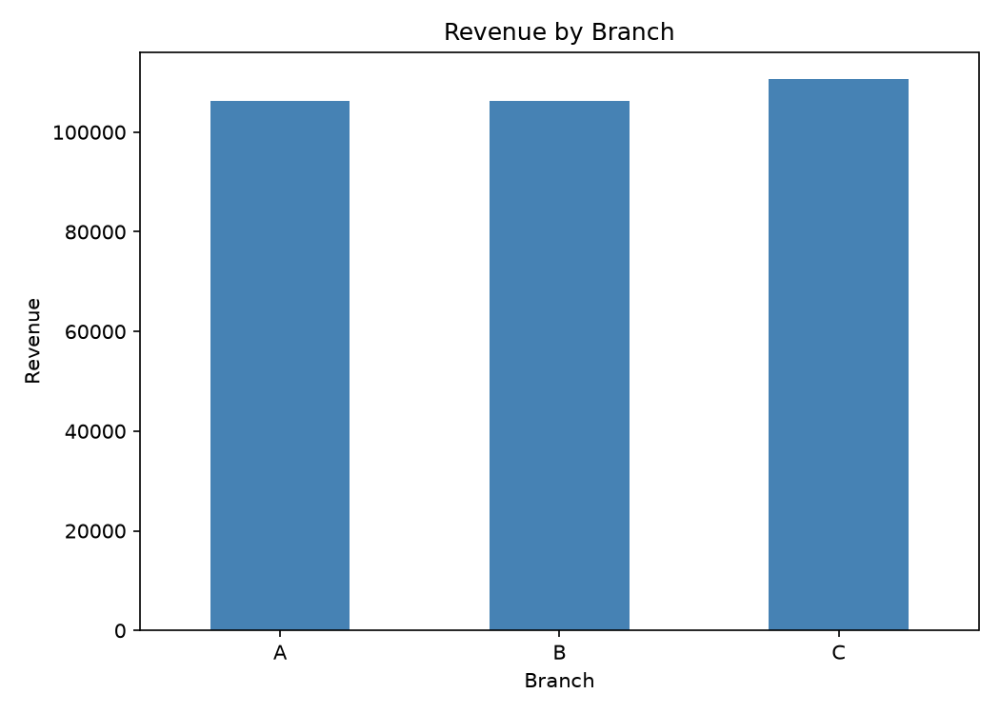
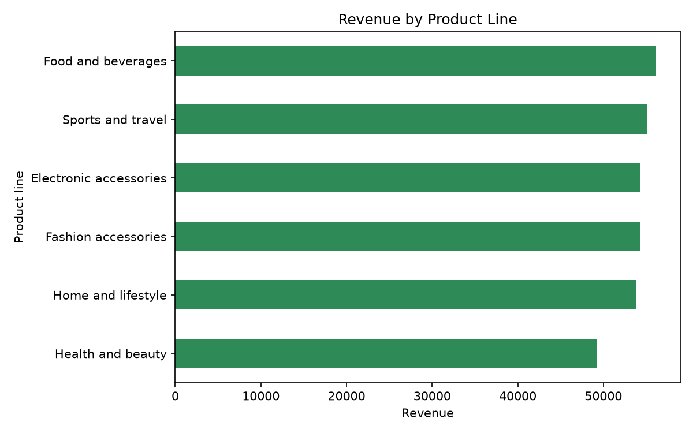
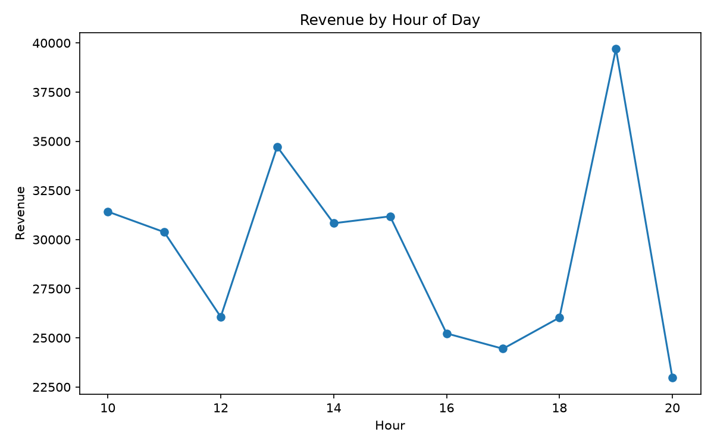
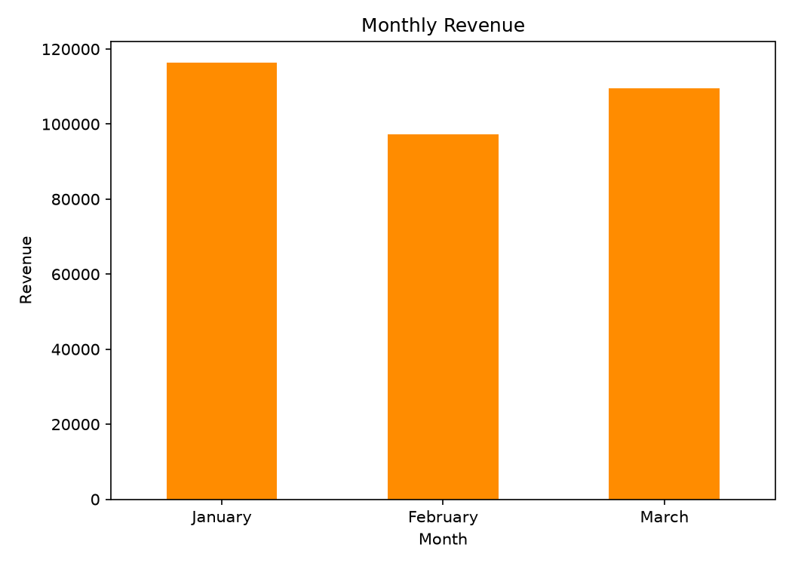
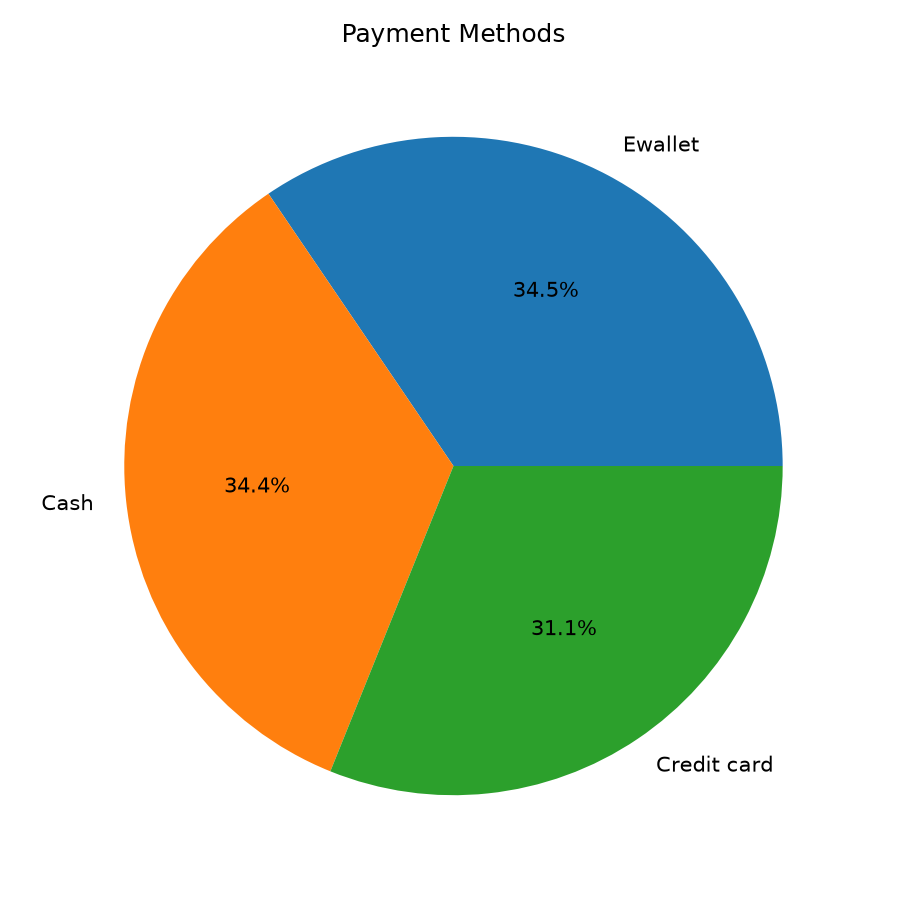
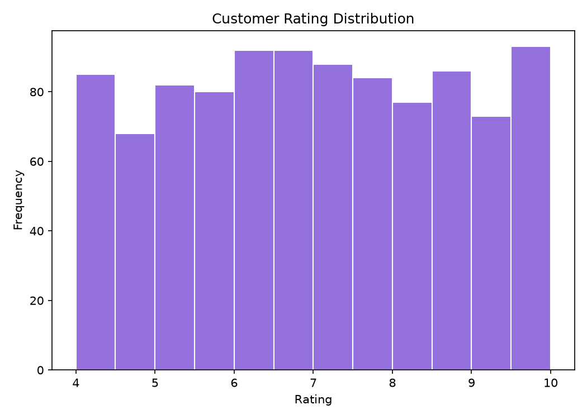

# 🛒 Supermarket Sales Analysis

> An end-to-end exploratory data analysis of **1,000 supermarket transactions** across **3 branches** and **3 cities** (Q1 2019) — uncovering revenue drivers, customer behavior, peak trading hours, and what actually moves customer satisfaction.


---

## 📌 Table of Contents

1. [Project Overview](#-project-overview)
2. [Business Questions](#-business-questions)
3. [Dataset](#-dataset)
4. [Project Structure](#-project-structure)
5. [Methodology](#-methodology)
6. [Key Findings](#-key-findings)
7. [Visualizations](#-visualizations)
8. [Recommendations](#-recommendations)
9. [Getting Started](#-getting-started)
10. [Limitations & Data Notes](#-limitations--data-notes)
11. [Tech Stack](#-tech-stack)
12. [Contact Metheds](#-Contact-Metheds)

---

## 🎯 Project Overview

A supermarket chain operating in three cities wants to understand **where its money comes from** and **how to grow it**. This project cleans, explores, and visualizes its sales data to answer practical business questions and turn raw transactions into actionable insights.

**What this project demonstrates:**

- Data loading, validation, and cleaning with **Pandas**
- Feature engineering from date/time fields (month, weekday, hour)
- Aggregation and group-based analysis (branch, product line, customer segment)
- Clear, publication-quality visualizations
- Translating numbers into business recommendations

---

## ❓ Business Questions

1. Which **branch** and **city** generate the most revenue?
2. Which **product lines** perform best — by revenue and by volume?
3. How do **Members** and **Normal** customers differ in spending?
4. Does **gender** influence basket size or spending?
5. Which **payment methods** do customers prefer?
6. What are the **peak hours and days** for sales?
7. How does revenue **trend over time**?
8. What drives **customer ratings**?

---

## 📂 Dataset

| Property | Value |
|---|---|
| **File** | `data/raw/sales_analysis.csv` |
| **Rows** | 1,000 transactions |
| **Columns** | 17 |
| **Period** | 1 Jan 2019 – 30 Mar 2019 |
| **Missing values** | None |
| **Duplicate invoices** | None (all `Invoice ID`s unique) |

### Data Dictionary

| Column | Type | Description |
|---|---|---|
| `Invoice ID` | string | Unique invoice identifier |
| `Branch` | categorical | Branch code (A, B, C) |
| `City` | categorical | City of the branch (Yangon, Mandalay, Naypyitaw) |
| `Customer type` | categorical | `Member` or `Normal` |
| `Gender` | categorical | Customer gender |
| `Product line` | categorical | One of 6 product categories |
| `Unit price` | float | Price per unit |
| `Quantity` | int | Units purchased (1–10) |
| `Tax 5%` | float | 5% tax on the purchase |
| `Total` | float | Total amount including tax |
| `Date` | date | Purchase date (`M/D/YYYY`) |
| `Time` | time | Purchase time (10:00 – 21:00) |
| `Payment` | categorical | Ewallet, Cash, or Credit card |
| `cogs` | float | Cost of goods sold (`Unit price × Quantity`) |
| `gross margin percentage` | float | Constant 4.76% across all rows |
| `gross income` | float | Gross income of the transaction |
| `Rating` | float | Customer satisfaction rating (4–10) |

---

## 🗂 Project Structure

```
sales_analysis/
├── data/
│   ├── raw/
│   │   └── sales_analysis.csv      # Original dataset (untouched)
│   └── processed/                  # Cleaned / feature-engineered data
├── images/                         # Exported charts used in this README
├── notebooks/
│   └── analysis.ipynb              # Full interactive analysis
├── src/
│   └── main.py                     # Script version of the analysis
├── .gitignore
└── README.md
```

---

## 🔬 Methodology

1. **Load & inspect** — shape, dtypes, null counts, descriptive statistics.
2. **Clean & validate** — parse `Date` and `Time`, verify no nulls/duplicates, check that `Total = cogs + Tax 5%`.
3. **Feature engineering** — extract `Month`, `Weekday`, and `Hour` from the timestamp.
4. **Aggregate** — group by branch, product line, customer type, gender, payment method, and time.
5. **Visualize** — bar charts, line charts, heatmaps, and distributions.
6. **Interpret** — convert findings into business recommendations.

---

## 📊 Key Findings

### 💰 Headline numbers

| Metric | Value |
|---|---|
| **Total revenue** | **$322,967** |
| **Average transaction value** | **$322.97** |
| **Total gross income** | **$15,379** |
| **Average customer rating** | **6.97 / 10** |

### 🏬 Branch performance

| Branch | City | Revenue | Transactions | Avg. Rating |
|---|---|---|---|---|
| **C** | Naypyitaw | **$110,569** | 328 | 7.1 |
| A | Yangon | $106,200 | 340 | 7.0 |
| B | Mandalay | $106,198 | 332 | 6.8 |

➡️ **Naypyitaw leads on revenue despite the fewest transactions** — customers there spend more per visit. Mandalay has the lowest satisfaction score.

### 🛍 Product lines (by revenue)

| Rank | Product line | Revenue |
|---|---|---|
| 1 | **Food and beverages** | $56,145 |
| 2 | Sports and travel | $55,123 |
| 3 | Electronic accessories | $54,338 |
| 4 | Fashion accessories | $54,306 |
| 5 | Home and lifestyle | $53,862 |
| 6 | Health and beauty | $49,194 |

➡️ Categories are **remarkably balanced** (top 5 within ~4% of each other). **Health and beauty** is the clear laggard, ~12% below the leader.

### 👥 Customers

- **Members** spend slightly more per transaction ($327.80 vs $318.10) and account for ~51% of revenue.
- **Female customers** have a higher average basket ($335.10 vs $310.80) and generate ~52% of revenue.

### 💳 Payment methods

Usage is almost evenly split: **Ewallet (34.5%)**, **Cash (34.4%)**, **Credit card (31.1%)** — no single dominant method.

### ⏰ When do customers buy?

- **Peak hour: 19:00** — the highest-revenue hour of the day (~$39.7K), followed by 13:00.
- **Peak day: Saturday** (~$56.1K) — the strongest day of the week; **Monday is the weakest** (~$37.9K).
- **Monthly revenue:** January $116.3K → February $97.2K → March $109.5K. (February is shorter, so it's partly a calendar effect.)

### ⭐ What drives ratings?

Correlation between `Rating` and `Unit price`, `Quantity`, and `Total` is **near zero** (|r| < 0.05). Customer satisfaction is **not explained by spend** — it likely depends on service, wait times, or stock availability, which this dataset doesn't capture.

---

## 🖼 Visualizations

> Charts are exported from the notebook into the `images/` folder.

| | |
|---|---|
|  |  |
|  |  |
|  |  |

---

## 💡 Recommendations

1. **Staff for the evening rush.** The 19:00 peak and Saturdays deserve extra cashiers and stocked shelves.
2. **Run promotions on slow periods.** Target Mondays and the mid-afternoon dip (16:00–17:00) with offers to flatten demand.
3. **Revive Health & Beauty.** The weakest category — test bundles, cross-promotions, or better placement.
4. **Investigate Mandalay's lower rating.** Collect qualitative feedback (service, queues, availability).
5. **Grow the Member base.** Members spend more per visit; convert Normal customers with targeted loyalty perks.
6. **Keep all payment options.** Usage is evenly split, so removing any method risks losing a third of customers.

---

## 🚀 Getting Started

### Prerequisites

- Python 3.10+
- pip

### Installation

```bash
# 1. Clone the repository
git clone https://github.com/<your-username>/sales_analysis.git
cd sales_analysis

# 2. (Recommended) create a virtual environment
python3 -m venv venv
source venv/bin/activate        # Windows: venv\Scripts\activate

# 3. Install dependencies
pip install pandas numpy matplotlib seaborn jupyter
```

### Run the analysis

```bash
# Option A — interactive notebook
jupyter notebook notebooks/analysis.ipynb

# Option B — script
python src/main.py
```

---

## ⚠️ Limitations & Data Notes

- **Short time window** — only ~3 months of data, so seasonality can't be assessed.
- **Constant margin** — `gross margin percentage` is identical (4.76%) in every row, so margin analysis across products or branches isn't possible.
- **`gross income` equals `Tax 5%`** in every row — in this dataset, "gross income" is just the tax amount, not true profit. Treat profitability conclusions with caution.
- **Balanced, likely synthetic data** — near-perfect splits (e.g., 501/499 for gender and customer type) suggest the dataset may be simulated, so findings are illustrative rather than real-world.
- **Ratings** range only from 4 to 10, with no low scores.

---

## 🧰 Tech Stack

- **Python** — core language
- **Pandas / NumPy** — data manipulation
- **Matplotlib / Seaborn** — visualization
- **Jupyter Notebook** — interactive analysis
- **Git & GitHub** — version control

---

##  Contact Methods

💼 [LinkedIn](https://www.linkedin.com/in/www.linkedin.com/in/marzieh-sahneh-ab1131420)


🐙 [GitHub](https://github.com/kiadev7777-Hub)

⭐ If you found this project useful, consider giving it a star!
